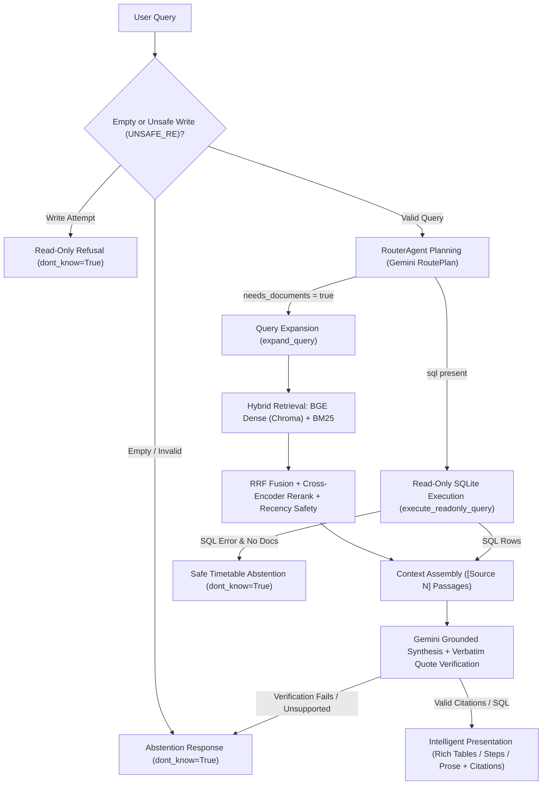

# Railway Passenger Help Desk

An intelligent railway passenger assistance system combining Retrieval-Augmented Generation, hybrid retrieval, document citations, and read-only SQL timetable querying.

[](https://github.com/qikkk333/root4/actions/workflows/ci.yml)
[](https://github.com/qikkk333/root4/actions/workflows/security.yml)


---

## 1. Project Overview

Railway passengers frequently need accurate answers spanning both **official Indian Railways rules and circulars** (ticket cancellation charges, TDR deadlines, Tatkal Aadhaar OTP requirements, advance reservation periods, reservation charting windows, and recent policy revisions) and **historical train schedules** (train numbers, station codes, intermediate halts, complete train routes, and journey durations). Generic LLMs often hallucinate numbers, miss newer circulars overriding older rules, fail to provide verifiable citations, or risk unsafe queries against SQL databases.

- **Intended Users:** Railway passengers seeking grounded answers through an interactive terminal menu/chatbot, and student engineers/developers maintaining, evaluating, and extending the RAG + SQL capstone codebase.
- **Core Capabilities:** Routes questions across official PDF/HTML policy documents and a pre-built 2016 SQLite timetable snapshot, enforces quote-verified citations or explicit abstention, and formats complex answers (including full multi-stop train routes, train comparisons, refund slabs, and Tatkal timings) into clear width-adaptive Rich terminal tables.
- **Key Boundaries:** Built strictly over a static 7-document policy corpus (`100` chunks) and an August 2016 timetable database (`5,208` trains, `8,990` stations); provides no live train status, PNR checks, current fares, seat availability, or real-time platform data.

---

## 2. Features

- **Gemini Integration & Router Architecture:** Uses Gemini via the OpenAI-compatible SDK inside [`RouterAgent`](app/helpdesk/agent.py) alongside switchable `rag`, `multi`, and `tools` agents behind the unified `ask(question)` contract `{"answer", "sources", "sql", "dont_know"}`.
- **Hybrid RAG Pipeline:** Combines dense semantic vector search in **ChromaDB** (`rail_chunks`, `100` pre-indexed chunks) using **`BAAI/bge-small-en-v1.5`** embeddings, railway code- and time-aware **BM25** lexical search (`rank-bm25`), rule-based query expansion, Reciprocal Rank Fusion (`RRF_K=60`), and **`cross-encoder/ms-marco-MiniLM-L-6-v2`** reranking with recency safety penalties ([`app/helpdesk/search.py`](app/helpdesk/search.py)).
- **Document Ingestion & OCR Support:** Parses PDFs (PyMuPDF bounding-box extraction) and HTML tables (BeautifulSoup4 splitting explicit `old` vs `revised` rules), running **RapidOCR** (`rapidocr-onnxruntime`) on scanned pages while filtering Hindi duplicates and noisy OCR fragments ([`app/helpdesk/ingest.py`](app/helpdesk/ingest.py)).
- **Read-Only SQLite Timetable Querying:** Executes safe `SELECT`/`WITH` timetable queries through 5 defense-in-depth protections: query prefix check, `?mode=ro` SQLite URI, `PRAGMA query_only = ON`, restrictive `sqlite3.set_authorizer`, and progress-handler timeout ([`app/helpdesk/sql.py`](app/helpdesk/sql.py)).
- **Verified Source Citations & Strict Abstention:** `_verify_grounded_response()` requires verbatim substring quotes tied to valid indexed `(doc, page)` pairs before answering, excludes SQL pseudo-documents from `sources`, refuses database writes pre-LLM, and abstains cleanly (`dont_know=True`) when sources lack support.
- **Project-Local Rich Launcher & Streamlined Chatbot UI:** One-command Windows launcher ([`helpdesk.ps1`](helpdesk.ps1), [`setup-helpdesk.ps1`](setup-helpdesk.ps1), [`helpdesk.cmd`](helpdesk.cmd)) manages Python 3.12 virtualenv bootstrap and 8-point read-only health checks, renders a dynamically centered Main Menu ([`app/helpdesk/cli.py`](app/helpdesk/cli.py)), opens passenger chat directly to `You: ` with `help` / `clear` / `exit` / `quit`, and applies semantic ANSI styling with `NO_COLOR` and non-TTY support.
- **Intelligent Structured Output & Complete Route Display:** [`classify_response_type()`](app/helpdesk/terminal_ui.py) deterministically chooses Rich tables for complete train routes (preserving all stops beyond 20/36 rows in DB order and chunking very long routes cleanly above 45 stops), train schedule comparisons, multi-row SQL results, cancellation/refund slabs, and Tatkal timings, while rendering procedures as numbered steps and factual replies as readable paragraphs.
- **Automated Testing & Offline Evaluation:** Includes `141` automated tests in [`app/tests/`](app/tests/) plus deterministic `--offline` benchmark suites (`37` main cases and `39` SQL/hybrid/refusal cases in [`app/eval/`](app/eval/)).

---

## 3. Architecture



---

## 4. Technology Stack

- **Language & Core Validation:** Python `3.12`, Pydantic (`pydantic==2.14.3`), `python-dotenv==1.2.2`
- **LLM Client:** OpenAI Python SDK (`openai==3.46.0`) targeting Gemini's OpenAI-compatible endpoint (`https://generativelanguage.googleapis.com/v1beta/openai/`)
- **Vector Store & Embeddings:** ChromaDB (`chromadb==1.5.9`), Sentence-Transformers (`sentence-transformers==6.2.0`), Transformers (`transformers==5.14.1`), PyTorch (`torch==2.14.1`), `rank-bm25==0.2.2`, NumPy (`numpy==2.4.6`)
- **Ingestion & OCR:** PyMuPDF (`pymupdf==2.1`), BeautifulSoup4 (`beautifulsoup4==4.15.0`), RapidOCR (`rapidocr-onnxruntime==1.2.3`)
- **Database:** SQLite (`database/rail_timetable.db`, read-only URI connection)
- **Terminal UI & Launcher:** Rich (`rich==15.0.0`), Python standard library (`shutil`, `textwrap`, `threading`, `ctypes`), Windows PowerShell (`helpdesk.ps1`, `setup-helpdesk.ps1`, `helpdesk.cmd`)
- **Testing, Linting & Security Tooling:** Pytest, Ruff, `pip-audit`, PyYAML ([`app/requirements-dev.txt`](app/requirements-dev.txt), [`pyproject.toml`](pyproject.toml))

---

## 5. Quick Start (Windows PowerShell)

All unit tests, health checks, and deterministic `--offline` evaluations work without a `GEMINI_API_KEY`. Live interactive chatbot queries require your personal key in `app/.env`.

### 1. Launch with the Project-Local Launcher

From the repository root in Windows PowerShell:

```powershell
cd path\to\root4
Set-ExecutionPolicy -Scope Process Bypass -Force
. .\setup-helpdesk.ps1
helpdesk
```

*(Alternative commands without session registration: `.\helpdesk.cmd` or `powershell.exe -NoProfile -ExecutionPolicy Bypass -File .\helpdesk.ps1`.)*

### 2. First-Time Setup vs Subsequent Runs

- **First run (no `app\.venv`):** Detects Python `3.12` and opens the **Environment Setup Menu** (`[1]` creates `app\.venv`, upgrades `pip` inside `.venv`, installs [`app/requirements.txt`](app/requirements.txt), verifies package imports, and copies [`app/.env.example`](app/.env.example) to `app/.env` if absent). Global Python packages, global `PATH`, and your PowerShell `$PROFILE` remain untouched.
- **Subsequent runs:** Reuses `app\.venv` immediately with zero `pip install` calls and automatically sets `HF_HUB_OFFLINE=1` when `BAAI/bge-small-en-v1.5` and `cross-encoder/ms-marco-MiniLM-L-6-v2` are already cached locally.
- **Manual repair / health check:** `.\helpdesk.ps1 --setup` repairs `app\.venv` non-destructively; `.\helpdesk.ps1 --health` or `.\helpdesk.cmd --health` runs the 8-point read-only diagnostics.

### 3. Configure `GEMINI_API_KEY` (For Live LLM Chat)

Open untracked `app\.env` (never commit `.env`) and add your key:

```ini
GEMINI_API_KEY=your_real_gemini_api_key
```

Optional environment variables: `HELPDESK_AGENT` (`router` default, `rag`, `multi`, `tools`), `AGENT_MODEL` (`gemini-3.5-flash-lite`), `AGENT_BASE_URL`, `AGENT_API_KEY_ENV`, `RAIL_TIMETABLE_DB_PATH`, `HF_HUB_OFFLINE=1`, `NO_COLOR=1`.

### 4. Direct Python `ask()` API & One-Shot CLI

```python
from app.helpdesk import ask  # from repo root (or `from helpdesk import ask` inside app/)

result = ask("When does train 12002 leave New Delhi?")
```

```powershell
# Interactive chatbot directly
.\app\.venv\Scripts\python.exe -m helpdesk.agent

# One-shot JSON contract output
.\app\.venv\Scripts\python.exe -m helpdesk.agent "Flat cancellation charge for sleeper?"
```

---

## 6. Project Structure

```text
root4/
├── .github/
│   ├── ISSUE_TEMPLATE/
│   │   ├── bug_report.yml          # Structured bug report form
│   │   ├── feature_request.yml     # Structured feature proposal form
│   │   └── config.yml              # Issue chooser configuration
│   ├── workflows/
│   │   ├── ci.yml                  # Automated compile, Ruff, pytest, & offline evals
│   │   ├── security.yml            # Secret hygiene, pip-audit, & CodeQL Python scan
│   │   └── release.yml             # Optional tag/manual source ZIP verification workflow
│   ├── dependabot.yml              # Weekly GitHub Actions & pip dependency update PRs
│   └── pull_request_template.md    # Standard PR & security review checklist
├── .gitignore
├── CONTRIBUTING.md                 # Team branching, commit, PR, & merge workflow guide
├── MANUAL_ACTIONS_REQUIRED.md      # Local API key & optional pack rebuild instructions
├── README.md
├── pyproject.toml                  # Ruff lint/format configuration & pytest testpaths
├── helpdesk.ps1                    # Project-local PowerShell launcher & env bootstrap
├── helpdesk.cmd                    # Windows CMD / Bypass wrapper
├── setup-helpdesk.ps1              # Session-local registration for `helpdesk` command
├── database/
│   ├── rail_timetable.db           # August 2016 SQLite Indian Railways timetable (5,208 trains)
│   └── schema.md                   # Schema reference & snapshot limitations
├── helpdesk/
│   └── sql.py                      # Compatibility shim delegating to app.helpdesk.sql
├── sql_tests/
│   ├── inspect_db.py               # Sample route verification script (JP -> UDZ)
│   └── test_sample_sql.py          # Standalone SQL read-only checks
└── app/
    ├── .env.example                # Environment template (copy to app/.env locally)
    ├── FUNCTIONS.txt               # Module & function reference
    ├── build_index.py              # Offline index builder (requires excluded source pack)
    ├── requirements.txt            # Pinned runtime dependencies
    ├── requirements-dev.txt        # Pinned dev dependencies (pytest, ruff, pip-audit, pyyaml)
    ├── run.txt                     # Detailed PowerShell runbook
    ├── dev/                        # Legacy initial prototype chunker (kept for fallback only)
    ├── eval/
    │   ├── README.md               # Retrieval, citation F1, & SQL scoring methodology
    │   ├── evaluate_agent.py       # Offline deterministic (--offline) & live evaluator
    │   ├── evaluate_retrieval.py   # Dense / BM25 / Hybrid retrieval benchmark
    │   ├── smoke_test_live.py      # 5-route live Gemini smoke test with Chroma isolation
    │   ├── experiments.md          # Measured retrieval experiment history
    │   ├── test_set*.json          # Main, hard, SQL, hybrid, & refusal evaluation datasets
    │   └── results/                # Output directory (.gitkeep tracked; *.json gitignored)
    ├── helpdesk/
    │   ├── __init__.py             # Lazy public ask(question) package export
    │   ├── agent.py                # Agents, Gemini wrapper, grounding, & RouterAgent
    │   ├── cli.py                  # Centered Rich main menu, setup wizard, health check & eval menu
    │   ├── env_setup.py            # Stdlib Python 3.12 venv bootstrap & health diagnostics
    │   ├── ingest.py               # PDF/HTML extraction, OCR, cleaning, & chunking
    │   ├── search.py               # Hybrid BGE dense + BM25 + cross-encoder search
    │   ├── sql.py                  # Authoritative read-only SQLite module
    │   └── terminal_ui.py          # Streamlined chatbot UI & intelligent Rich formatters
    ├── index/
    │   ├── chroma/                 # Pre-built ChromaDB vector collection (100 chunks)
    │   ├── chunks.json             # Validated 100-chunk text & 3-level metadata store
    │   └── manifest.json           # Index metadata
    └── tests/
        ├── test_adaptive_formatting.py # Dynamic menu centering, complete routes & Rich tables
        ├── test_agent_api.py           # Public API, config, error separation & grounding
        ├── test_cli_chatbot.py         # Chatbot prompt, color rules, wrapping & CLI compatibility
        ├── test_evaluation.py          # Dataset integrity, citation F1 & dual-module Chroma isolation
        ├── test_launcher_and_menu.py   # Launcher scripts, env setup, health checks & menu navigation
        ├── test_reliability.py         # 20 reliability & failure-mode scenario tests
        ├── test_retrieval_audit.py     # Index manifest, ingest & search retrieval tests
        └── test_sql_integration.py     # SQLite read-only security & routing tests
```

---

## 7. Testing & Continuous Integration

Run every automated check locally before committing:

```powershell
# 1. Bytecode compilation check
python -m compileall -q app

# 2. Full automated pytest suite (runs offline without GEMINI_API_KEY)
python -m pytest app/tests -v

# 3. Code quality checks (Ruff)
ruff check app
ruff format --check app

# 4. Deterministic offline evaluation suites (no API key or external calls)
$env:HF_HUB_OFFLINE = "1"
.\app\.venv\Scripts\python.exe app\eval\evaluate_agent.py --offline --suite main
.\app\.venv\Scripts\python.exe app\eval\evaluate_agent.py --offline --suite all

# 5. Live Gemini smoke test (requires GEMINI_API_KEY in app/.env)
.\app\.venv\Scripts\python.exe app\eval\smoke_test_live.py
```

*(Install dev tools locally with `pip install -r app/requirements-dev.txt`. See [app/eval/README.md](app/eval/README.md) for citation and SQL metrics.)*

### GitHub Actions CI/CD & Security

- **[CI Workflow](.github/workflows/ci.yml):** Runs on every push and PR to `main` and `gemini-integration` on `ubuntu-latest` (`Python 3.12`), verifying bytecode compilation, `ruff check` / `ruff format --check`, YAML syntax validation, `pytest app/tests -v`, and both offline evaluations (`--suite main` and `--suite all`).
- **[Security Workflow](.github/workflows/security.yml):** Runs secret/private-key/hygiene scanning across tracked files, `pip-audit` vulnerability checking across `app/requirements.txt` and `app/requirements-dev.txt`, and CodeQL static analysis for Python.
- **[Dependabot](.github/dependabot.yml):** Checks GitHub Actions and Python dependencies (`app/`) weekly and opens PRs for review without auto-merging.

---

## 8. Known Limitations

1. **Historical August 2016 Timetable Snapshot ([`database/schema.md`](database/schema.md)):**
   - Reflects 2016 timetable data (`5,208` trains, `8,990` stations, `417,080` schedule entries); later train numbers/timings and post-2018 station codes differ (e.g., Mumbai Central uses historical code `BCT` rather than `MMCT`, and Vande Bharat Express services are not in the SQL database).
   - **No live running status, live PNR status, real-time platform numbers, live seat availability, waiting-list predictions, or real-time fare guarantees.**
   - About half of stations lack `state` or `zone` values, and class flags (`has_*`) are incomplete on unreserved trains.
2. **Policy Document Corpus Coverage:**
   - Covers 7 English/OCR-processed official documents (`100` chunks = `93` content + `7` overview). Duplicate Hindi scans (`rb_cc08_2025_tatkal.pdf` pp. 3–5, `rb_cc10_2024_advance_reservation.pdf` p. 2, `rb_cc10_2025_reservation_charts.pdf` p. 1, `rb_cc08_2026_vande_bharat_sleeper_refund.pdf` pp. 3–4) and blank scan `rb_cc08_2025_tatkal.pdf` p. 6 are excluded at ingest.
   - Retrieval applies recency penalties when newer March 2026 PIB revisions update older January 2026 rules unless historical wording is requested.
3. **Operational & Tooling Boundaries:**
   - Raw source PDF/HTML files (`app/rail_capstone_pack/`) are excluded via `.gitignore`; do not rebuild `app/index/` without extracting the original pack locally.
   - Read-only SQL display queries allow up to `1,000` rows per query (sufficient for the longest single-train schedule in the snapshot at `698` rows) and display an explicit warning if truncated.
   - In [`security.yml`](.github/workflows/security.yml), four currently unpatched upstream `chromadb==1.5.9` HTTP-server/RBAC advisories (`PYSEC-2026-311`, `3813`, `3814`, `3815`) are explicitly documented and waived because no fixed upstream release exists yet (`fix_versions=[]`) and this application uses local embedded `PersistentClient` only with no HTTP server exposed.

---

## 9. Team & Contributions

Contributions from team members and reviewers are welcome via feature branches and Pull Requests targeting `main` or `gemini-integration` (please do **not** push unfinished work directly to `main`).

- Read [CONTRIBUTING.md](CONTRIBUTING.md) for branching naming (`feature/`, `fix/`, `docs/`, `test/`), commit prefixes, local setup, merge-conflict resolution, and secret-protection rules.
- Use [Pull Request Template](.github/pull_request_template.md) and Issue forms ([Bug Report](.github/ISSUE_TEMPLATE/bug_report.yml), [Feature Request](.github/ISSUE_TEMPLATE/feature_request.yml)).
- Repository administrators should configure **Branch Protection on `main`** (require PRs before merging, require **CI** and **Security** checks to pass, require conversation resolution, and block force pushes and branch deletions).

---

## 10. License

No `LICENSE` file is currently included in this repository. Usage, modification, and redistribution terms remain with the repository authors until an explicit license file is added.
