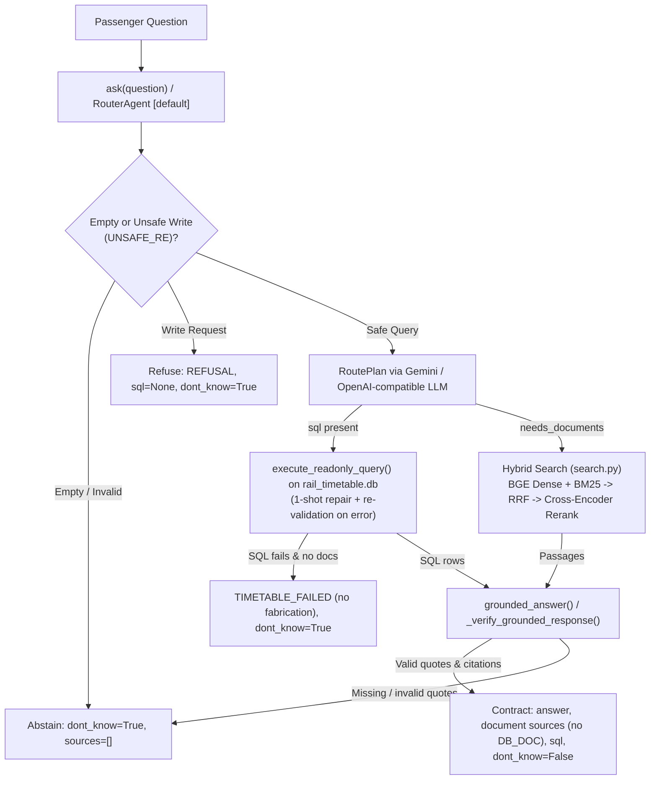

# Railway Passenger Help Desk (`root4`)

Hybrid Retrieval-Augmented Generation (RAG) + Read-Only SQL Indian Railways Passenger Help Desk built for the GenAI Nexus Fellowship Capstone Project.

---

## 1. Project Overview, Problem Statement & Objectives

### Problem Statement
Railway passengers ask mixed questions spanning **official policy documents** (cancellation charges, TDR deadlines, Tatkal rules, advance reservation periods, reservation charts, recent circular updates) and **timetable schedules** (train numbers, station codes, intermediate halts, routes, overnight journey durations). Standard LLM assistants hallucinate policy numbers or train timings, fail to prioritize newer circulars over superseded ones, cannot verify citations, and risk unsafe SQL writes if connected naively to a database.

### Objectives
- Expose a reliable unified Python API (`ask(question)`) returning the capstone contract: `{"answer", "sources", "sql", "dont_know"}`.
- Route questions automatically via [`RouterAgent`](app/helpdesk/agent.py) across policy documents, the historical 2016 SQLite timetable database, mixed queries, out-of-scope requests, and unsafe database modification attempts.
- Enforce strict read-only SQLite execution through five defense-in-depth protections ([`app/helpdesk/sql.py`](app/helpdesk/sql.py)).
- Verify every factual answer against verbatim quotes and valid indexed `(doc, page)` citations before responding, abstaining safely when evidence is insufficient.
- Provide reproducible retrieval, SQL, hybrid, refusal, and citation precision/recall evaluation suites (`app/eval/`).

---

## 2. System Architecture



---

## 3. Technology Stack

Pinned runtime packages in [`app/requirements.txt`](app/requirements.txt):

- **LLM Client & Validation:** `openai==3.46.0` (Gemini OpenAI-compatible endpoint `https://generativelanguage.googleapis.com/v1beta/openai/`), `pydantic==2.14.3`, `python-dotenv==1.2.2`
- **Dense Embeddings & Reranker:** `sentence-transformers==6.2.0` (`BAAI/bge-small-en-v1.5`, `cross-encoder/ms-marco-MiniLM-L-6-v2`), `transformers==5.14.1`, `torch==2.14.1`
- **Vector Store & Lexical Retrieval:** `chromadb==1.5.9` (cosine HNSW collection `rail_chunks`), `rank-bm25==0.2.2`, `numpy==2.4.6`
- **Document Parsing & OCR:** `pymupdf==2.1`, `beautifulsoup4==4.15.0`, `rapidocr-onnxruntime==1.2.3`
- **Database:** SQLite (`database/rail_timetable.db`, read-only URI connection)
- **Testing:** `pytest` (offline deterministic integration & unit suites in [`app/tests/`](app/tests/))

---

## 4. Workflows & Core Mechanisms

### Document Ingestion ([`app/helpdesk/ingest.py`](app/helpdesk/ingest.py) & [`app/build_index.py`](app/build_index.py))
- Extracts text and bounding-box-aware tables via PyMuPDF; scanned PDF pages (`< 50` text chars) run through `RapidOCR` at 300 DPI.
- Filters Hindi pages (`devanagari_share > 0.3`) and low-quality OCR fragments (`< 80` English words, `english_quality < 0.12`).
- Splits HTML refund comparison tables into explicit `old` and `revised` chunks (`rule_status`) and preserves 3-level metadata (document -> page -> section/topic/scope/date).
- Packs paragraphs cleanly up to `CHUNK_SIZE=900` (`TABLE_CHUNK_SIZE=1400`) and builds 1 overview chunk per document -> 103 total chunks in [`app/index/chunks.json`](app/index/chunks.json) and `app/index/chroma/`.

### Hybrid Retrieval ([`app/helpdesk/search.py`](app/helpdesk/search.py))
1. **Rule-based query expansion (`expand_query`):** Expands railway abbreviations (`SL` -> `sleeper class`, `2AC` -> `AC 2 tier`, `CNF`, `WL`, `TDR`, `ARP`), days -> hours, and `am/pm` -> 24-hour times without LLM calls.
2. **Dual retrievers:** Dense cosine search (`BAAI/bge-small-en-v1.5` with `QUERY_INSTRUCTION` on queries only) + code-aware BM25 tokenizer (`G.S.R. 41(E)`, `10/2025`, `06:15`).
3. **Fusion & reranking:** Reciprocal Rank Fusion (`RRF_K=60`) -> normalized deduplication -> cross-encoder reranking (`ms-marco-MiniLM-L-6-v2` top 20) -> recency penalties (`OLD_RULE_PENALTY=2.0`, `STALE_DOC_PENALTY=2.0` skipped only for explicit historical queries matching `PAST_RE`) -> `OVERVIEW_PENALTY=3.0`.

### Read-Only SQL Integration ([`app/helpdesk/sql.py`](app/helpdesk/sql.py) & [`helpdesk/sql.py`](helpdesk/sql.py))
- `app/helpdesk/sql.py` is the single authoritative SQL layer; root [`helpdesk/sql.py`](helpdesk/sql.py) delegates cleanly to it.
- Resolves [`database/rail_timetable.db`](database/rail_timetable.db) relative to `Path(__file__).resolve()` (override via `RAIL_TIMETABLE_DB_PATH` or `db_path=`). Missing DB paths fail safely without creating empty files.
- Five defense-in-depth layers inside `execute_readonly_query()`:
  1. `is_select_query()` enforces `SELECT` / `WITH` prefix.
  2. Read-only URI mode (`?mode=ro`).
  3. `PRAGMA query_only = ON`.
  4. `readonly_authorizer` allowing only `SQLITE_SELECT`, `SQLITE_READ`, `SQLITE_FUNCTION`, `SQLITE_RECURSIVE` (explicitly blocking `INSERT`, `UPDATE`, `DELETE`, `DROP`, `CREATE`, `ALTER`, `ATTACH`, `PRAGMA`, `VACUUM`, `REPLACE`, `load_extension`, `fts3_tokenizer`).
  5. Parameter binding, single-statement cursor execution, bounded rows (`1 <= max_rows <= 1000`), and `set_progress_handler` query timeout (`5.0s`).

### Gemini Integration, Grounding, Citations & Abstention ([`app/helpdesk/agent.py`](app/helpdesk/agent.py))
- **`RouterAgent` (default):** Intercepts explicit write requests pre-LLM via `UNSAFE_RE`, plans `RoutePlan(needs_documents, doc_query, sql)` (1-shot SQL syntax repair revalidated through `execute_readonly_query()`), fuses retrieved passages with SQL rows, and synthesizes answers via `grounded_answer(..., allow_db=bool(used_sql))`.
- **Switchable strategies:** `router` (default), `rag`, `multi`, and `tools` (`ToolAgent` enforces the same verbatim `evidence` quote + citation metadata verification).
- **Error separation:** `_is_api_error()` separates auth/permission/not-found/rate-limit/server/network/timeout errors from structured-output `BadRequestError`/`ValidationError` schema fallbacks so genuine API failures return `SERVICE_ERROR` instead of silently falling back or claiming missing documents.
- **Evidence & citation verification:** `grounding_problems()`, `_valid_citation_entry()`, `sources_of()`, and `_verify_grounded_response()` require non-empty/non-trivial verbatim quotes (`>= 2` tokens, whole-token containment), valid 1-based indices, valid page/document metadata (integer `page >= 1` for `.pdf`, `None` allowed for `.html`), and exclude SQL `DB_DOC` (`"timetable database"`) from `out["sources"]`. Failed verification retries once, then abstains (`dont_know=True`).

---

## 5. Repository Layout

```text
root4/
├── .gitignore
├── MANUAL_ACTIONS_REQUIRED.md     # Remaining user-only actions (API key, live smoke & push)
├── README.md
├── database/
│   ├── rail_timetable.db          # 2016 SQLite Indian Railways timetable snapshot
│   └── schema.md                  # Schema reference & snapshot limitations
├── helpdesk/
│   └── sql.py                     # Compatibility shim re-exporting app.helpdesk.sql
├── sql_tests/
│   ├── inspect_db.py              # Sample route inspection script (JP -> UDZ)
│   └── test_sample_sql.py         # Standalone SQL smoke checks
└── app/
    ├── .env.example               # Placeholder env config (copy to app/.env)
    ├── FUNCTIONS.txt              # Detailed module/function documentation
    ├── build_index.py             # Offline index builder (requires local source pack)
    ├── requirements.txt           # Pinned Python package versions
    ├── run.txt                    # PowerShell usage & evaluation guide
    ├── eval/
    │   ├── README.md              # Evaluation formulas & citation metric conventions
    │   ├── evaluate_agent.py      # Offline deterministic (--offline) & live Gemini evaluator
    │   ├── evaluate_retrieval.py  # Dense / BM25 / Hybrid retrieval benchmark
    │   ├── smoke_test_live.py     # Safe live Gemini smoke-test script (5 end-to-end probes)
    │   ├── experiments.md         # Measured retrieval experiment history
    │   ├── test_set.json          # 37 document + abstention benchmark items
    │   ├── test_set_hard.json     # 25 paraphrased/abbreviated retrieval items
    │   ├── test_set_sql.json      # 17 verified 2016 SQLite timetable questions
    │   ├── test_set_hybrid.json   # 10 docs-only / SQL-only / mixed / abstain questions
    │   ├── test_set_refusal.json  # 12 out-of-scope abstention & unsafe-write attacks
    │   └── results/               # Reproducible evaluation report output directory
    ├── helpdesk/
    │   ├── __init__.py            # Lazy public ask(question) export
    │   ├── agent.py               # Agents, Gemini LLM wrapper, grounding, RouterAgent
    │   ├── ingest.py              # Document extraction, cleaning & chunking
    │   ├── search.py              # Hybrid dense + BM25 + cross-encoder retrieval
    │   └── sql.py                 # Authoritative read-only SQLite module
    ├── index/
    │   ├── chroma/                # Pre-built ChromaDB vector collection (103 chunks)
    │   ├── chunks.json            # Validated chunk store with 3-level metadata
    │   └── manifest.json          # Index build metadata
    └── tests/
        ├── test_agent_api.py      # Public API, config, error separation & grounding tests
        ├── test_evaluation.py     # SQL/hybrid/refusal dataset & citation metrics tests
        ├── test_reliability.py    # 20 end-to-end reliability & failure-mode scenario tests
        ├── test_retrieval_audit.py # Corpus manifest, ingest & search retrieval tests
        └── test_sql_integration.py # SQLite security, routing & CWD-independence tests
```

---

## 6. Installation & Environment Configuration (Windows PowerShell)

1. Use the existing virtualenv in `app/.venv` (or create one with Python 3.12 and install [`app/requirements.txt`](app/requirements.txt)):

```powershell
# Using pre-installed app/.venv, or install from scratch:
python -m venv app\.venv
.\app\.venv\Scripts\python.exe -m pip install -r app\requirements.txt
.\app\.venv\Scripts\python.exe -m pip install pytest
```

*(Note: In this workspace, `app/.venv` has all runtime dependencies from `app/requirements.txt`, while `pytest` runs from the environment where `pytest` is installed.)*

2. Copy [`app/.env.example`](app/.env.example) to `app/.env` and set your Gemini API key:

```powershell
Copy-Item app\.env.example app\.env
```

Environment variables supported (loaded from `app/.env`, then repo-root `.env`, then current working directory `.env` with `override=False`):
- `GEMINI_API_KEY`: Required for live Gemini LLM calls (never commit `.env`).
- `HELPDESK_AGENT`: Default `router` (`router | rag | multi | tools`).
- `AGENT_MODEL`: Default `gemini-3.5-flash-lite`.
- `AGENT_BASE_URL`: Default `https://generativelanguage.googleapis.com/v1beta/openai/`.
- `AGENT_API_KEY_ENV`: Default `GEMINI_API_KEY`.
- `RAIL_TIMETABLE_DB_PATH`: Optional SQLite path override.

---

## 7. Public `ask()` API & CLI Usage (Windows PowerShell)

```python
# From app/
from helpdesk import ask

# Or from repository root
from app.helpdesk import ask

result = ask("When does train 12002 leave New Delhi?")
```

Every call returns:

```python
{
    "answer": str,
    "sources": [{"doc": str, "page": int | None}],
    "sql": str | None,
    "dont_know": bool,
}
```

CLI commands (from `app/`):

```powershell
$env:HF_HUB_OFFLINE="1"

# Ask a single question (defaults to --agent router; requires GEMINI_API_KEY)
.\.venv\Scripts\python.exe -m helpdesk.agent "When does train 12002 leave New Delhi?"

# Interactive chat or switch strategy
.\.venv\Scripts\python.exe -m helpdesk.agent --chat --agent router
.\.venv\Scripts\python.exe -m helpdesk.agent "Flat cancellation charge for sleeper?" --agent rag

# Retrieval-only inspection (free, no Gemini key needed)
.\.venv\Scripts\python.exe -m helpdesk.search "SL cancel 3 days before"
```

---

## 8. Running Tests & Evaluations (Windows PowerShell)

All automated pytest suites and standalone SQL/retrieval/offline evaluation checks run deterministically offline without a `GEMINI_API_KEY`:

```powershell
# 1. Complete offline pytest suite from repo root (or inside app/: pytest tests -v)
python -m pytest app/tests -v

# 2. Standalone SQL verification scripts
.\app\.venv\Scripts\python.exe sql_tests\inspect_db.py
.\app\.venv\Scripts\python.exe sql_tests\test_sample_sql.py

# 3. Offline retrieval benchmark (no LLM; uses cached HF models offline)
$env:HF_HUB_OFFLINE="1"
.\app\.venv\Scripts\python.exe app\eval\evaluate_retrieval.py --verbose
.\app\.venv\Scripts\python.exe app\eval\evaluate_retrieval.py --questions app\eval\test_set_hard.json

# 4. Deterministic offline SQL + Hybrid + Refusal + Citation evaluation
.\app\.venv\Scripts\python.exe app\eval\evaluate_agent.py --offline --suite all --out app\eval\results\offline_report.json

# 5. Live Gemini smoke test & end-to-end evaluation (requires GEMINI_API_KEY in app/.env)
.\app\.venv\Scripts\python.exe app\eval\smoke_test_live.py
.\app\.venv\Scripts\python.exe app\eval\evaluate_agent.py --agent router --suite all --out app\eval\results\live_report.json
```

See [`app/eval/README.md`](app/eval/README.md) for exact retrieval, citation precision/recall, and SQL scoring definitions.

---

## 9. Data & System Limitations

1. **Historical 2016 Timetable Snapshot ([`database/schema.md`](database/schema.md)):**
   - `database/rail_timetable.db` reflects August 2016 data (`5,208` trains, `8,990` stations, `417,080` schedules). Train timings/numbers and newer station codes differ from current operations (for example, Mumbai Central uses historical code `BCT` rather than post-2018 `MMCT`, and Vande Bharat Express trains are absent).
   - Contains **no live running status, current ticket fares, PNR status, seat availability, waiting-list predictions, or platform numbers**.
   - Station `state` and `zone` fields are `NULL` for roughly half of stations; `trains.has_*` class flags are incomplete on unreserved trains.
2. **Policy Document Corpus Coverage:**
   - 7 English/OCR-processed policy documents (103 chunks). Bilingual Hindi scanned pages filtered at ingest (for example, `rb_cc10_2025_reservation_charts.pdf` page 1) are absent from `chunks.json` (English page 2 is indexed).
   - March 2026 PIB press release revises older January 2026 IRCTC cancellation time windows (`48/12/4` -> `72/24/8` hours); retrieval applies recency penalties unless historical wording is used.
3. **Operational & Verification Boundaries:**
   - Deterministic quote verification confirms verbatim substring support and valid indexed citations, not full semantic NLI entailment between paraphrase and quote.
   - Raw source PDF/HTML files (`app/rail_capstone_pack/`) are excluded via `.gitignore` and absent from Git; do not rebuild `app/index/` without restoring the source pack.
   - Live Gemini API calls require manual configuration of `GEMINI_API_KEY`; see [`MANUAL_ACTIONS_REQUIRED.md`](MANUAL_ACTIONS_REQUIRED.md).
